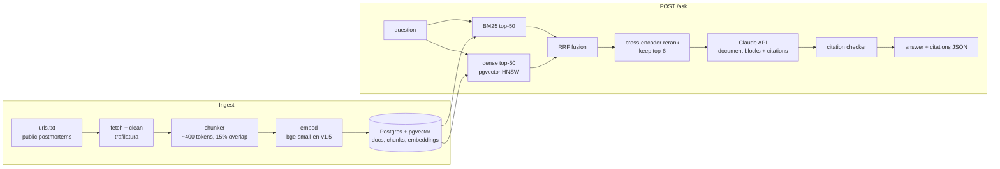

# RCA Copilot: Hybrid RAG over Incident Postmortems

When something breaks in production, the fastest way to a root cause is often
*"has anyone seen this before?"* Hundreds of companies publish detailed postmortems,
but they are scattered across blogs and status pages and hard to search by symptom.
RCA Copilot is a small, containerised RAG service over those **public postmortems**.
Ask it a question ("which outages were caused by an expired TLS certificate?") and it
retrieves the relevant passages with **BM25 + dense-embedding hybrid search**, re-scores
them with a **cross-encoder**, and has Claude write an answer in which **every claim
carries an inline citation** back to the source postmortem. A golden question set runs
in CI and tracks **Recall@K** and **answer faithfulness** on every change.

## Architecture



| Stage | Where | What it does |
|---|---|---|
| Fetch + clean | `app/ingest/fetch.py` | 1 req/s, descriptive User-Agent, `robots.txt` respected, raw HTML cached in `data/raw/` (git-ignored); trafilatura → markdown; drops pages < 1,500 chars and logs why (`data/skipped.jsonl`) |
| Chunk | `app/ingest/chunk.py` | split on headings, pack paragraphs to ~400 tokens with ~60 tokens overlap; `"{title} — {heading}"` is prepended to the *embedded* text only |
| Store | `app/db.py` | `documents` + `chunks(embedding vector(384))` with an HNSW cosine index; ingestion is idempotent (content hash) |
| BM25 | `app/retrieval/bm25.py` | real Okapi BM25 via `bm25s` (lowercase, punctuation stripped, English stopwords removed), persisted to disk |
| Dense | `app/retrieval/dense.py` | bge query-instruction prefix, normalised vectors, `ORDER BY embedding <=> q LIMIT 50` |
| Fusion | `app/retrieval/fusion.py` | Reciprocal Rank Fusion, `k = 60`, keep 30 |
| Rerank | `app/retrieval/rerank.py` | `cross-encoder/ms-marco-MiniLM-L-6-v2` on the 30 fused candidates, keep 6; below a calibrated score → "not in corpus" without calling Claude |
| Generate | `app/generation/answer.py` | each chunk is its own `document` block with `citations: {enabled: true}`; citations are mapped back to chunk ids / URLs and rendered as `[n]` |
| Check | `app/generation/cite_check.py` | splits the answer into sentences, reports `citation_coverage` and returns every uncited sentence |

## Quickstart

```bash
cp .env.example .env            # add ANTHROPIC_API_KEY
make up                         # docker compose up -d --build: db (pgvector) + api on :8000
make ingest                     # fetch + index the public postmortems in data/urls.txt
make stats                      # document / chunk counts

curl -s localhost:8000/ask -H 'content-type: application/json' \
  -d '{"question": "Which postmortems blame an expired TLS certificate?"}' | python3 -m json.tool
curl -s -G localhost:8000/search --data-urlencode 'q=leap second' | python3 -m json.tool   # retrieval only, no LLM
```

OpenAPI docs are at <http://localhost:8000/docs>. For local development without the api
container: `python -m venv .venv && .venv/bin/pip install torch --index-url https://download.pytorch.org/whl/cpu && .venv/bin/pip install -e ".[dev]"`,
start only the database (`docker compose up -d db`) and use `make LOCAL=1 <target>`.

### API

| Method | Path | Body / query | Returns |
|---|---|---|---|
| `GET` | `/health` | — | db ok, corpus counts, index loaded, model names |
| `GET` | `/search` | `q`, `k` | ranked chunks with per-stage ranks and scores (BM25, dense, RRF, rerank); no LLM call |
| `POST` | `/ask` | `{"question": str, "k": int = 6}` | `answer` (inline `[n]`), `citations[{n, chunk_id, doc_title, url, cited_text}]`, `uncited[]`, `citation_coverage`, `not_found`, `retrieval[]`, `usage`, `latency_ms` |
| `POST` | `/ingest` | header `X-Admin-Token` | ingestion counts (disabled unless `ADMIN_TOKEN` is set) |

## Results

<!-- RESULTS:START -->
_Generated by `make report` from `eval/results/latest.json` (suite `full`, 2026-11-23T11:07:09+00:00)._

| Metric | Value |
|---|---|
| Corpus | 199 postmortems / 2064 chunks (83 companies) |
| Golden set | 67 questions (7 unanswerable, 8 cross-document) |
| Golden items human-verified | 0 / 67 |
| Recall@5 (doc, hybrid + rerank) | 97.8% |
| Recall@10 (doc, hybrid + rerank) | 98.6% |
| MRR@10 | 0.983 |
| Faithfulness (LLM judge, mean per answer) | — skipped (no ANTHROPIC_API_KEY) |
| Citation coverage (cited factual sentences) | — |
| Abstention accuracy (unanswerable) | — |
| False abstention (answerable) | — |
| Latency p50 / p95 | — |
| Cost per question | — |
| Judge–human agreement | not measured yet (`make judge-sample`, label, `make judge-score`) |

**Retrieval ablation** (same questions, same first-stage candidates):

| Retriever | Recall@5 | Recall@10 | MRR@10 | Evidence Recall@5 |
|---|---|---|---|---|
| BM25 only | 98.6% | 99.2% | 0.975 | 88.6% |
| Dense only (bge-small) | 94.0% | 97.8% | 0.928 | 80.7% |
| Hybrid (RRF) | 96.9% | 99.2% | 0.972 | 88.6% |
| Hybrid + cross-encoder rerank | 97.8% | 98.6% | 0.983 | 91.9% |

Config: `TOP_K_BM25=50`, `TOP_K_DENSE=50`, `FUSED_K=30`, `RERANK_K=6`, `RRF_K=60`, `RERANK_THRESHOLD=-7.4`, chunks ≈400 tokens / 60 overlap, generator `claude-opus-5-5` (effort `medium`), judge `claude-sonnet-5-5`.

> ⚠️ 67 golden items are LLM-drafted and not yet human-verified (`make verify-golden`). Treat the numbers as provisional until this reads 0.

> Answer-quality metrics were not computed in this run: skipped (no ANTHROPIC_API_KEY).
<!-- RESULTS:END -->

### How the evaluation works

- **Golden set** — `eval/golden.jsonl`: factual-lookup, cross-document and paraphrased
  questions plus unanswerable ones whose correct output is "not in corpus". Each item lists
  `relevant_doc_ids` and short verbatim `evidence` phrases; `relevant_chunk_ids` are derived
  from the evidence, so labels survive re-chunking and are easy to audit. Questions were
  **drafted with an LLM from sampled chunks** and are then read and confirmed one by one by a
  human (`make verify-golden` records `verified_by`). The results table shows how many items
  are verified.
- **Retrieval** (`eval/retrieval_eval.py`, no API key): doc-level Recall@5 / Recall@10, MRR@10
  and **Evidence Recall@5** for **BM25 only, dense only, hybrid (RRF) and hybrid + rerank**, all
  computed from the same first-stage candidates. Evidence Recall@5 counts a relevant postmortem
  only if a chunk *containing the labelled evidence* is in the top 5, not just any chunk of that
  document; that is what grounding needs, because only the top 6 chunks reach Claude.
- **Reading the ablation.** Most golden questions name the company or date of an incident, so
  doc-level recall is close to the ceiling for every retriever and BM25 does very well on it
  (exact names are what BM25 is good at). The retrievers separate on **cross-document** and
  **paraphrased** questions and on **Evidence Recall** / **MRR**, i.e. whether the passage that
  answers the question is ranked high enough to be sent to the model. That is where the
  cross-encoder earns its cost.
- **Answers** (`eval/faithfulness_eval.py`): a Claude judge (`JUDGE_MODEL`, structured output
  via `messages.parse`) splits each answer into atomic claims and checks each one against the
  text of the chunks the answer cites → *supported / total*. Plus citation coverage,
  abstention accuracy on unanswerable items, false-abstention rate, cost and p50/p95 latency.
- **Judge calibration** — `make judge-sample` exports 20 judged answers; a human labels each
  claim; `make judge-score` reports agreement and Cohen's κ in the table above.
- **CI** (`.github/workflows/ci.yml`) on every push and PR: `ruff` + `pytest` (no network, no
  key), then a pgvector service container ingests the **synthetic** fixture corpus in
  `tests/fixtures/` (fictional companies written for the test, so no third-party text is
  committed), runs the retrieval eval and **fails if Recall@5 drops more than 2 points below
  `eval/baseline.json`**. On pushes to `main`, where the `ANTHROPIC_API_KEY` secret is
  available, it also runs the answer eval on 10 questions and fails if faithfulness drops
  more than 3 points. `latest.json` is uploaded as a build artefact.

## Design decisions

| Component | Choice | Why |
|---|---|---|
| Web framework | FastAPI + Pydantic v2 | typed request/response models, OpenAPI docs for free |
| Database | Postgres 16 + `pgvector` (HNSW) | one store for metadata and vectors; `hnsw.ef_search` is raised to 100 so a `LIMIT 50` query actually returns 50 rows |
| Embeddings | `BAAI/bge-small-en-v1.5` (384-d, local) | strong small model, no API cost, reproducible in CI; Anthropic doesn't ship an embeddings model |
| Lexical | `bm25s` | real BM25 (IDF + length normalisation); Postgres `ts_rank` is not BM25. Exact tokens matter in postmortems: error codes, `retention.ms`, `NXDOMAIN`, product names |
| Fusion | Reciprocal Rank Fusion, `k = 60` | uses ranks only, so unbounded BM25 scores and cosine similarities never need normalising against each other; robust with no tuning |
| Reranker | `cross-encoder/ms-marco-MiniLM-L-6-v2` | reads question and passage *together*, which a bi-encoder can't; ~30 CPU forward passes per query is cheap |
| Generator | Claude (`claude-opus-5-5`, effort `medium`) via the `anthropic` SDK | the native Citations feature returns machine-checkable spans tied to a `document_index`; Citations can't be combined with structured outputs, so the JSON is assembled from content blocks. Server-side refusal fallback (`fallbacks: "default"`) is on by default (`USE_SERVER_FALLBACK`) |
| Abstention | calibrated cross-encoder threshold + model instruction | the threshold (`make calibrate`) is set to keep every answerable golden question, so it only filters clearly off-topic questions and saves their Claude call. "Near-miss" unanswerables (right incident, missing detail, e.g. "how much did the outage cost?") score as high as real questions, so Claude's own "not in the corpus" instruction has to catch those |
| Diversity | `MAX_CHUNKS_PER_DOC` cap, off by default | capping chunks per postmortem helps "which outages…" questions but measured lower Evidence Recall, because the answer passage is often a document's 2nd–3rd best chunk |
| Dedup | 5-word-shingle Jaccard ≥ 0.8 at ingest | the public list contains the same postmortem under two URLs (archive.org copies); duplicates waste top-k slots |
| Prompt injection | system prompt is a constant; chunks travel only as `document` blocks; the prompt says documents are untrusted data | postmortems are scraped web text (`tests/test_guard.py`) |
| HTML → text | `trafilatura` (markdown output) | robust boilerplate removal and headings preserved for heading-aware chunking |

## Repository layout

```
app/        config, db, ingest/ (fetch, chunk, run), retrieval/ (bm25, dense, fusion, rerank, pipeline),
            generation/ (prompt, answer, cite_check), service.py, api.py
eval/       golden.jsonl, retrieval_eval.py, faithfulness_eval.py, run.py, gate.py, calibrate.py,
            judge_agreement.py, baseline.json, results/latest.json
tests/      unit tests (+ fixtures/: synthetic postmortems and their golden set for CI)
scripts/    build_urls.py (regenerates data/urls.txt), report.py (README tables), verify_golden.py
data/       urls.txt only; fetched text, raw HTML and indexes are git-ignored
```

## Limitations and next steps

- **Labels are the weak point.** The golden set is small and was drafted by an LLM from
  sampled chunks, which biases it toward questions whose answer sits in one easy-to-find
  passage, toward the vocabulary of the source, and toward naming the company, which makes
  doc-level recall nearly saturated. More symptom-style questions ("our deploys hang after a
  DNS change, has anyone seen this?") would make the ablation more informative. Cross-document recall labels are only as
  complete as the reviewer's knowledge of the corpus: an unlabelled relevant postmortem counts
  as a miss.
- **Threshold calibrated on the same set it is evaluated on**, so abstention accuracy is
  optimistic; it needs a held-out split once the golden set grows.
- **The judge is an LLM.** Faithfulness is only as good as the judge; the judge–human
  agreement row is the check on that.
- **Corpus drift.** Pages change or disappear; the raw HTML cache makes runs reproducible on
  one machine but the corpus is not redistributable, by design.
- **CPU-only, single process.** Fine for a few hundred documents. At 10M chunks: tune HNSW
  (`m`, `ef_construction`, `ef_search`) or move to IVF-PQ / a dedicated vector store, replace the
  in-memory BM25 with a sharded search engine (OpenSearch / Elasticsearch), cache query
  embeddings and rerank results, batch the cross-encoder on a GPU, and make the API async.
- **English only.** Non-English paragraphs of bilingual pages are dropped at ingest.

## Data and licensing

Only the **list of URLs** (`data/urls.txt`, built from the public
[danluu/post-mortems](https://github.com/danluu/post-mortems) list by `scripts/build_urls.py`)
and the ingestion code are committed. Postmortem text is fetched by `make ingest` into the
local database and cache; every chunk keeps its source URL so citations link back to the
original publisher.
